# Prison Escape 3D

**Play the model prisoner. Plan the perfect escape.**

A 3D prison escape game in the spirit of *The Escapists*, for phones and desktops, right in the browser.
Keep your head down through roll calls and work shifts while you secretly craft tools, dig, bribe, bluff and
plot your way out of five prisons, each harder than the last.

### ▶ [Play it now](https://manuelsiuro.github.io/PrisonEscape3D/)

No download and no account. It plays in the browser, can be installed as an app and then works offline. In
English and French.

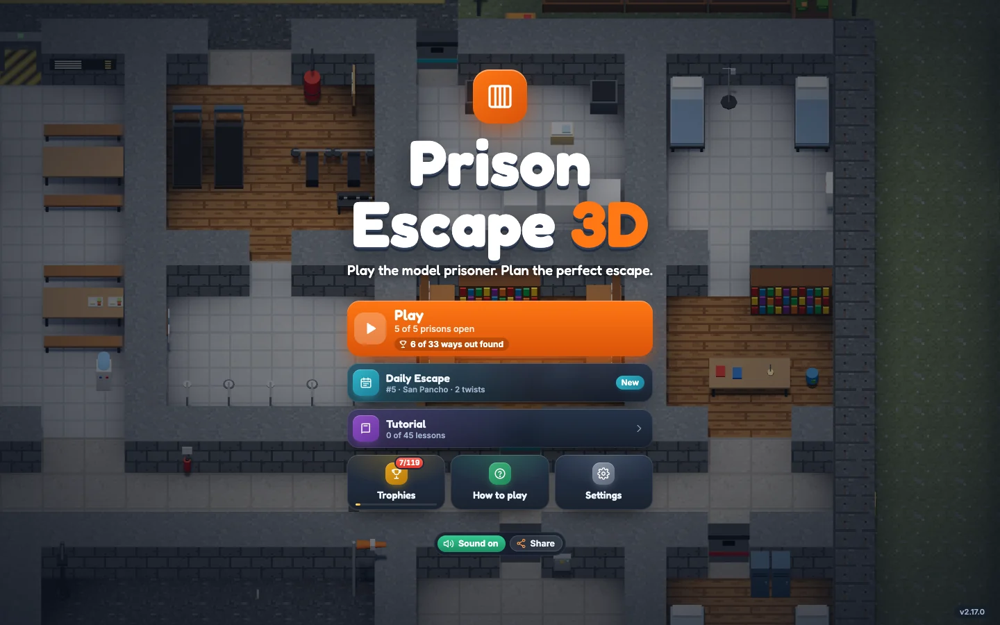

## The game

You arrive at Center Perks, a quiet minimum-security prison, with an orange jumpsuit and empty pockets. The
day runs on a strict timetable: roll call, meals, work, exercise, showers, lights out. Miss it and the
guards notice. Your **heat** rises, guards follow you, and too much of it ends in a chase, a beating and a
spell in solitary peeling potatoes.

But the routine is also your cover. Between roll calls you search desks, trade with other inmates, take a
job, train, learn recipes, and quietly build what you need. Then one night, you go.

<table>
  <tr>
    <td width="78%">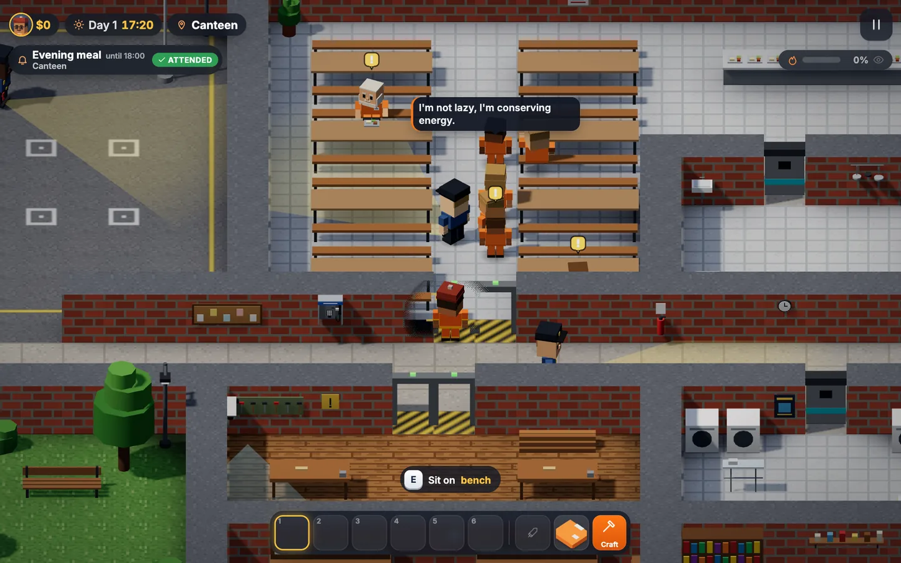</td>
    <td width="22%">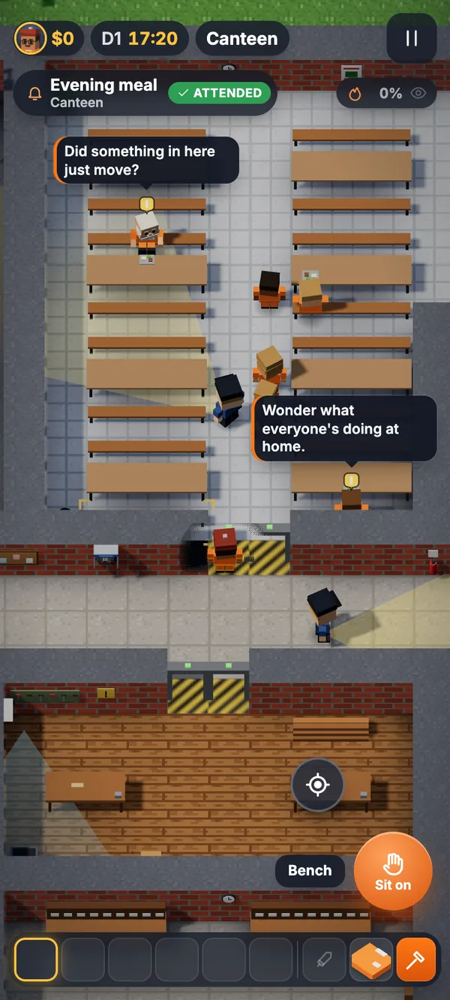</td>
  </tr>
  <tr>
    <td align="center"><em>Dinner time: the guards' vision cones, inmates' chatter and the day's routine</em></td>
    <td align="center"><em>On a phone</em></td>
  </tr>
</table>

### Prison life

- **A living prison.** Inmates follow the routine, chat, gossip and hold grudges. The rumours you overhear are
  true, if you know how to read them. Every guard has a name and a temperament: some are lazy and doze off,
  some are strict and search cells, and a few can be bribed.
- **Make your own tools.** 133 items to find, buy, steal or craft: from a toothbrush shiv and a wire
  lockpick to a bed dummy, a sheet rope, a grapnel and a glider. Intelligence opens harder recipes.
- **Work and money.** Seven jobs, merchants among the inmates, favors to do for cash, a black market with a
  fixer, a burner phone, drone drops and visitors.
- **Free time.** Card games of Cheat, checkers, dice, arm-wrestling, hoops, football matches, rat
  racing, a prison garden, tattoos, talent nights, quiz nights, a pay phone and an internet kiosk.
- **Friends and a crew.** Win people over, recruit them, and post a lookout who whistles when a guard comes.
  Tame a rat to fetch things for you. Make friends with the guard dog.
- **Days that differ.** Fire drills, inspections, delivery and visiting days, sports days, movie nights and
  food fights; fog, rain, storms, snow, blizzards and heatwaves.

### 33 ways out

Cut the fence, tunnel under the wall, cross the roofs, knock out nearly every guard at once so the gates open, hide in the
delivery truck, put on a guard's uniform and bluff your way through the gate, glide off a roof on the wind,
forge your release papers, or take a raft or a helicopter off the island. Each prison allows its own set of
these, and each way out you find is recorded, with a gold, silver or bronze medal for how fast you made it.

### Five prisons

Escape one to open the next.

<table>
  <tr>
    <td width="33%" align="center">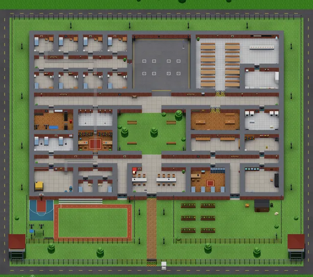<br><b>Center Perks</b><br>minimum security<br><em>Chain-link fences and a few detectors: learn the ropes.</em></td>
    <td width="33%" align="center">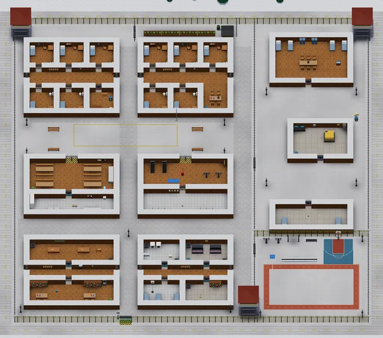<br><b>Stalag Flucht</b><br>medium security<br><em>An alpine camp: live wire, granite under the snow and a cold that saps you.</em></td>
    <td width="33%" align="center">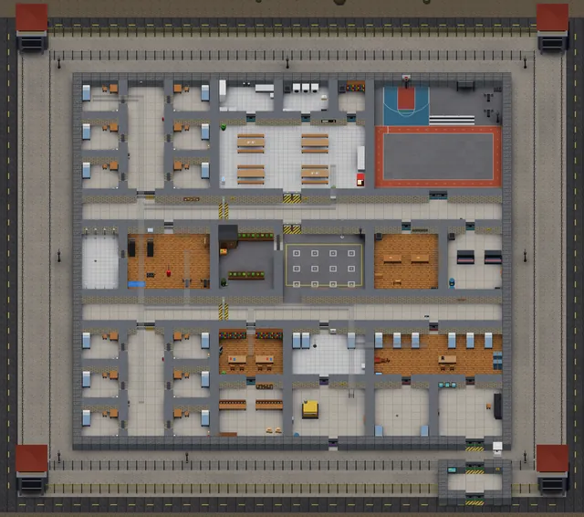<br><b>Shankton State Pen</b><br>high security<br><em>A concrete shell no tool can chip, detectors in every corridor, two fences.</em></td>
  </tr>
  <tr>
    <td width="33%" align="center">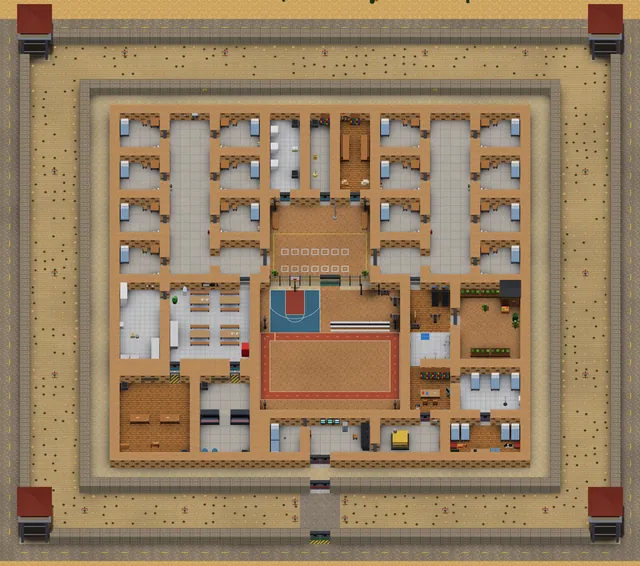<br><b>San Pancho</b><br>maximum security<br><em>A desert compound: a minefield between two walls and snipers who never sleep.</em></td>
    <td width="33%" align="center">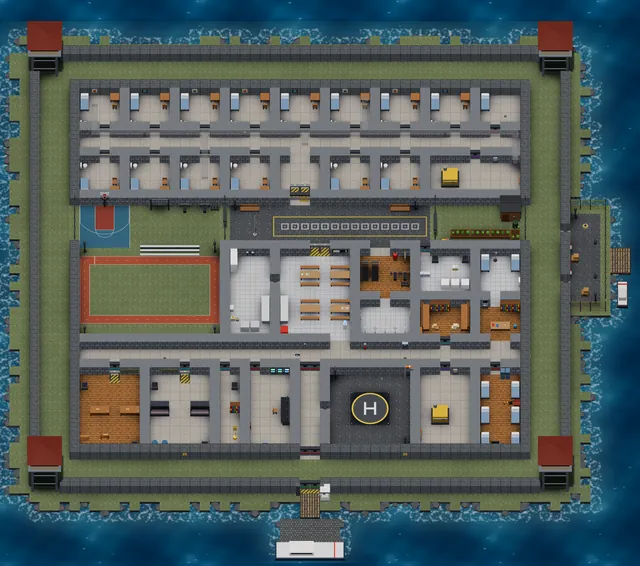<br><b>HMP Irongate</b><br>supermax<br><em>A fortress on a rock in the sea: tunnels flood, and the only ways off are by sea or by air.</em></td>
    <td width="33%" align="center">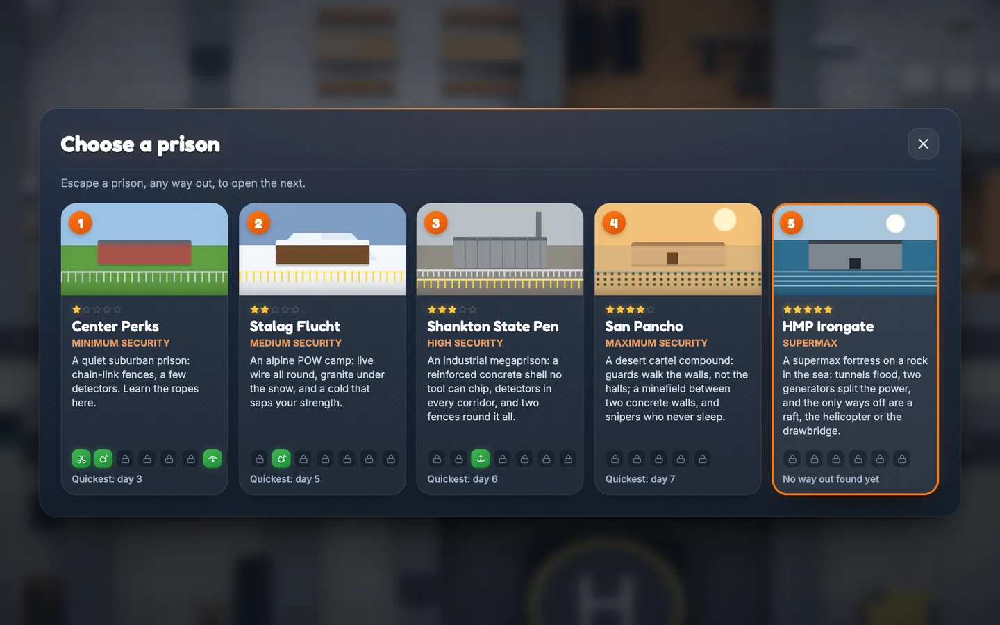<br><b>Choose a prison</b><br><em>With the ways out you've found and your best time in each.</em></td>
  </tr>
</table>

### Learn as you go, and keep playing

<table>
  <tr>
    <td width="28%">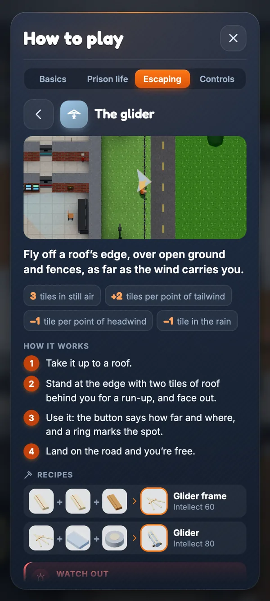</td>
    <td width="72%">
      <ul>
        <li><b>A tutorial of 45 short lessons</b> in four chapters (First steps, Getting by, Prison life, Ways out), each played in a real prison scene.</li>
        <li><b>How to play</b>: 54 topics, each on one page, with an in-game picture, the numbers that matter, step-by-step instructions, recipes and a button to play its lesson.</li>
        <li><b>The Daily Escape</b>: one prison a day, with twists, the same for everyone, and a streak to keep.</li>
        <li><b>Replays</b> of your escapes.</li>
        <li><b>119 achievements</b> and medals. Many of them unlock clothes and looks for your prisoner.</li>
        <li><b>Your own prisoner</b>: name, face, hair, beard, build, hat, glasses and tattoos.</li>
        <li>Three save slots plus the game in progress.</li>
      </ul>
    </td>
  </tr>
</table>

<table>
  <tr>
    <td width="50%">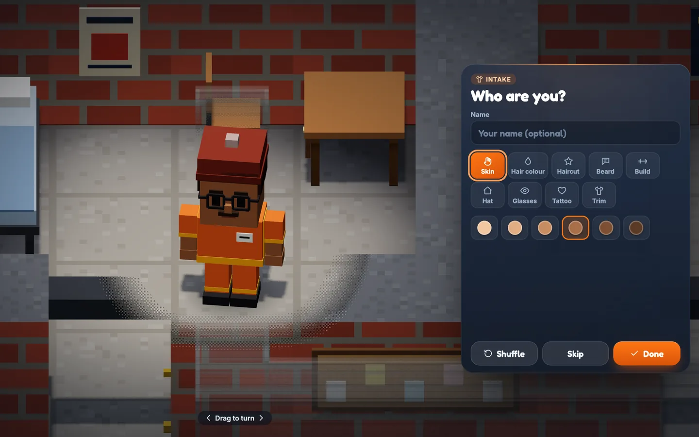</td>
    <td width="50%">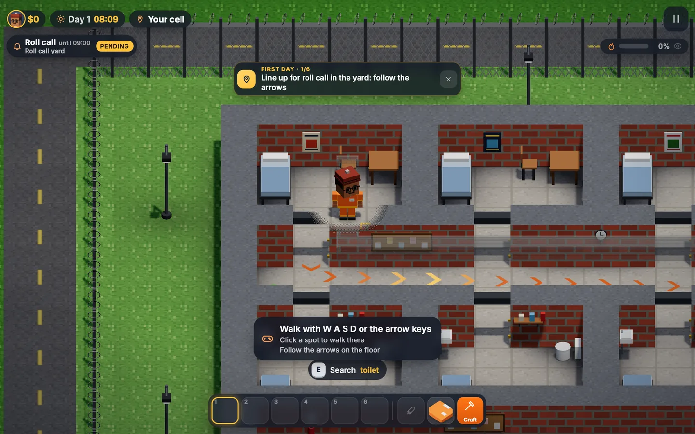</td>
  </tr>
  <tr>
    <td align="center"><em>Intake: who are you?</em></td>
    <td align="center"><em>The first day: arrows on the floor show the way</em></td>
  </tr>
  <tr>
    <td>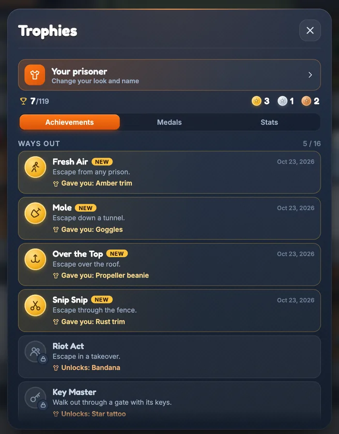</td>
    <td>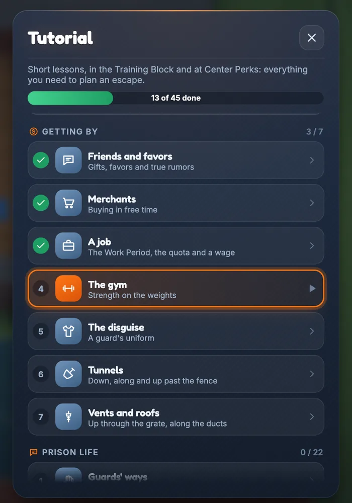</td>
  </tr>
  <tr>
    <td align="center"><em>Achievements, medals and stats</em></td>
    <td align="center"><em>The tutorial, chapter by chapter</em></td>
  </tr>
</table>

### Gallery

| | |
|:---:|:---:|
| 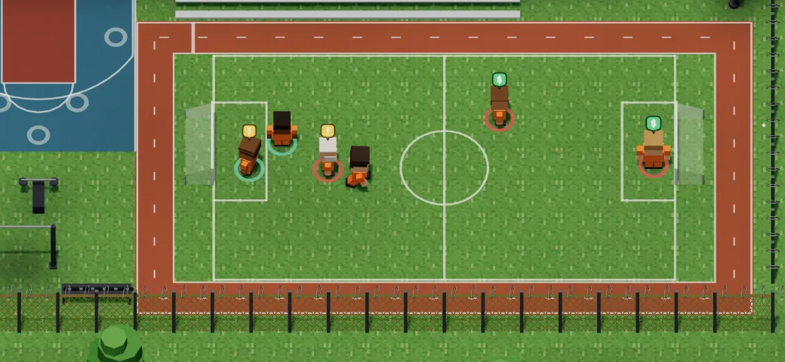 | 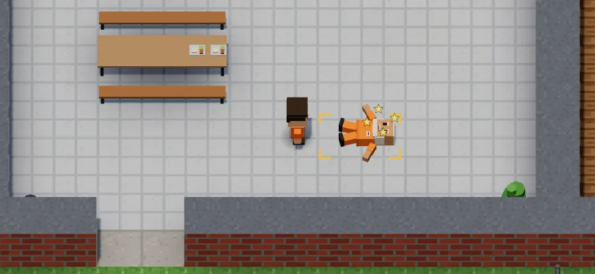 |
| *Football in the yard* | *Fights leave someone on the floor* |
| 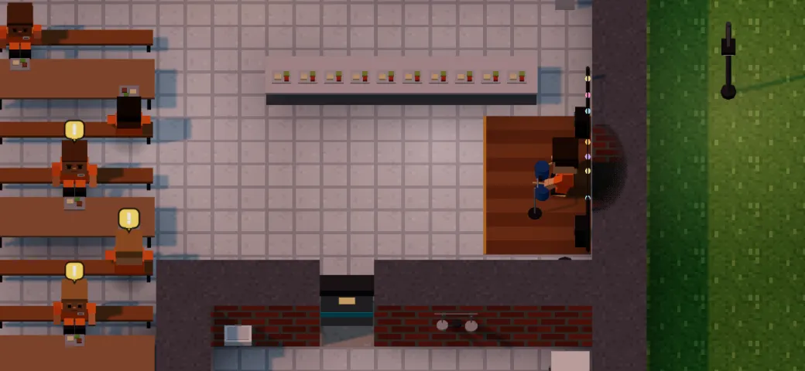 | 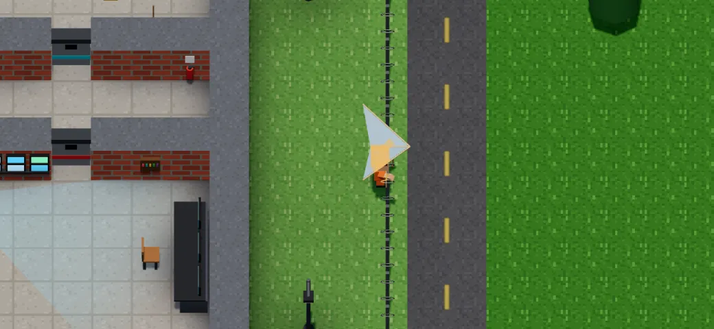 |
| *Talent night* | *Off the roof on the glider* |
| 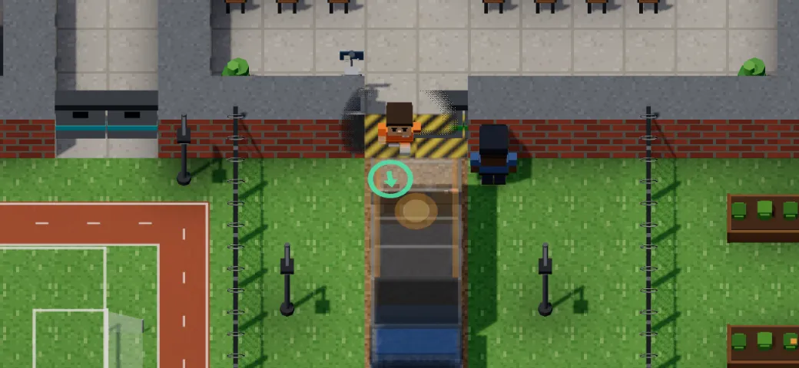 | 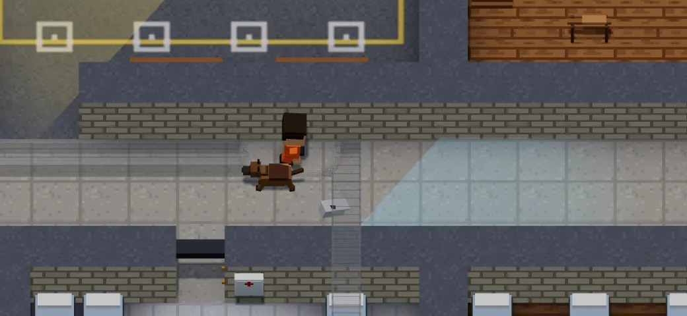 |
| *Delivery day* | *The guard dog* |
| 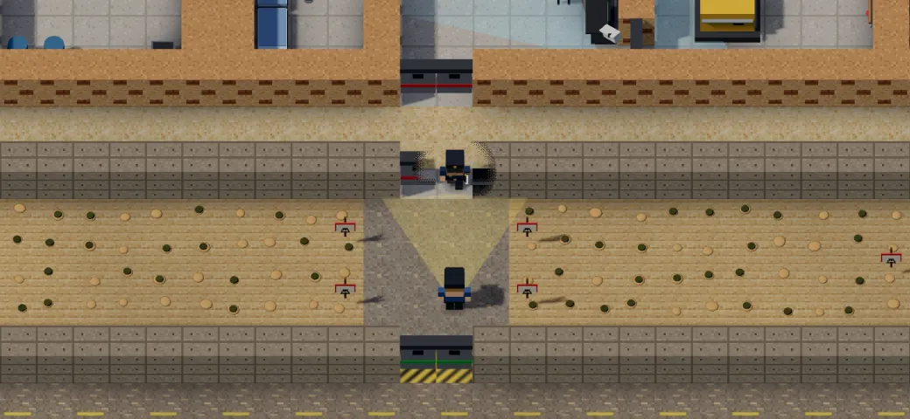 | 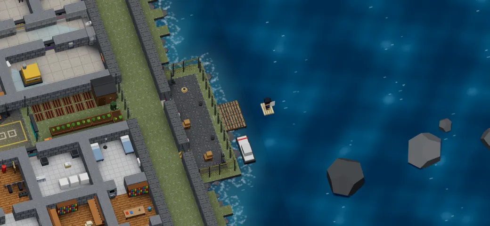 |
| *San Pancho's minefield* | *Off Irongate by raft* |

## Controls

| | Keyboard and mouse | Touch |
|---|---|---|
| Walk | W A S D or the arrow keys; click a spot to walk there | Drag anywhere (a stick appears under your thumb), or tap a spot |
| Act | E: search, pick up, open, talk, sit, sleep | The action button |
| Use the tool in hand, hit | Space | The use button |
| Items | 1–6 to hold one, Q to drop it, C to craft | Tap the hotbar, then the hammer to craft |
| Throw | Hold the right mouse button to aim; F throws straight ahead | The throw button |
| Panels | I your file, T the rat, P the phone, G the crew, H how to play | Their buttons on the HUD |
| Zoom, pause | Mouse wheel, Esc | Pinch, the pause button |

On an AZERTY keyboard the game reads the keys where they are (Z Q S D) and shows their real labels.

---

## Technical notes

Vite + TypeScript + Three.js, with **no models, textures or sound files**: the prisons, characters and
items are built in code, and the music and sound effects are synthesized. About 80,000 lines of TypeScript
in 280 files.

### Running it

```sh
npm ci
npm run dev       # dev server on port 5310 (also on your network, to test on a phone)
npm test          # 47 headless tests (npm test -- -u accepts new snapshots)
npm run build     # type-check and build to dist/
npm run check     # type-check and test
npm run maps      # redraw the map viewer (assets/maps/index.html)
```

Pushing to `main` runs CI (build and tests) and publishes the game on GitHub Pages. A release:
build and tests pass → commit → `npm version minor` (or `patch`) → `git push --follow-tags origin main`.

### How it's built

- **A deterministic simulation** (`src/sim/`). Fixed 20 Hz steps, integer positions, its own random number
  generator in the state, and no DOM, clock or Three.js. Every input (keyboard, touch, or a test's bot) is
  a packed command, so a game is its start state plus a list of commands. That is what the saves, the
  replays, the Daily Escape and the tests are built on.
- **Content is data** (`src/content/`). Each prison is an ASCII map plus its zones, cells, props, guards and
  escape routes. `maptest` checks every map: every floor reachable, the prison closed, props on floor, zones
  on every floor tile.
- **Tested by bots.** `scripts/*test*.ts` run headless against golden snapshots in `scripts/snapshots/`.
  Escape bots play every way out of every prison, and lesson bots play every tutorial lesson. Other tests
  cover the routine, guards, heat, combat, the economy, every free-time game, the i18n tables and the help
  pages.
- **The view** (`src/render/`). Instanced tiles, procedural characters and props, a see-through cut in the
  walls around the player, day and night, weather, and three graphics quality tiers that step down while
  frames run slow.
- **The UI** (`src/ui/`, `src/styles/`). Plain DOM screens, each a function returning a Promise, styled
  with design tokens and checked at desktop size, 412×915 and 915×412. All text goes through `t()` in
  `src/i18n/` (about 3,750 keys in English and French).
- **Storage** goes only through `src/game/storage.ts`: versioned, never throws, with migrations.
- **An installable app**: a service worker that stores the whole game for offline play and offers updates.

### Layout

| Path | What |
|---|---|
| `src/sim/` | The simulation: `Sim`, commands, the recorder; the world, AI (paths, autopilot) and systems (routine, guards, heat, combat, economy, security, games…) |
| `src/content/` | The prisons (`prisons/<id>/`), items, recipes, routine, achievements, the Daily Escape's twists |
| `src/render/` | The Three.js view: tiles, props, characters, guards' cones, security, weather, the island, the sports grounds |
| `src/play/` | A game in progress: the loop, input to commands, the HUD's live parts, lessons, mini-games |
| `src/flows/` | The title, intake, tutorial and Daily Escape flows |
| `src/ui/` | The HUD, panels and screens (title, prisons, how to play, trophies, settings…) |
| `src/talk/` | Speech bubbles: who says what, when, and gossip that is always true |
| `src/tutorial/` | The 45 lessons and their chapters |
| `src/game/` | Saves, settings, records, trophies, stats, replays and storage |
| `src/replay/` | Watching an escape again |
| `src/audio/`, `src/app/` | Synthesized sound; haptics, graphics quality, the service worker |
| `src/i18n/` | English and French text, the inmates' and guards' lines (`barks/`), keyboard labels |
| `src/styles/` | CSS, one file per part of the game |
| `scripts/` | Tests (`*test*.ts`), escape bots (`escapes.ts`), and dev tools in `scripts/dev/` (map viewer, How to play pictures, map photos) |
| `assets/maps/` | The map viewer: every prison drawn from its data, with in-game photos |
| `public/help/` | How to play's in-game pictures |
| `docs/` | The game design document, tech plan, the project plan with every phase's history, these screenshots |

### Documents

- [`docs/the_escapists_3d_complete_game_design_document.md`](docs/the_escapists_3d_complete_game_design_document.md): the game design document, the source of truth.
- [`docs/PLAN.md`](docs/PLAN.md): decisions, conflicts resolved, the phases (P0 to P38) and the history of every release.
- [`docs/tech_plan.md`](docs/tech_plan.md): engineering details the design document leaves open.
- [`CLAUDE.md`](CLAUDE.md): the rules for working on the code.
